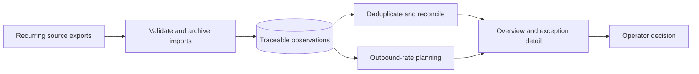
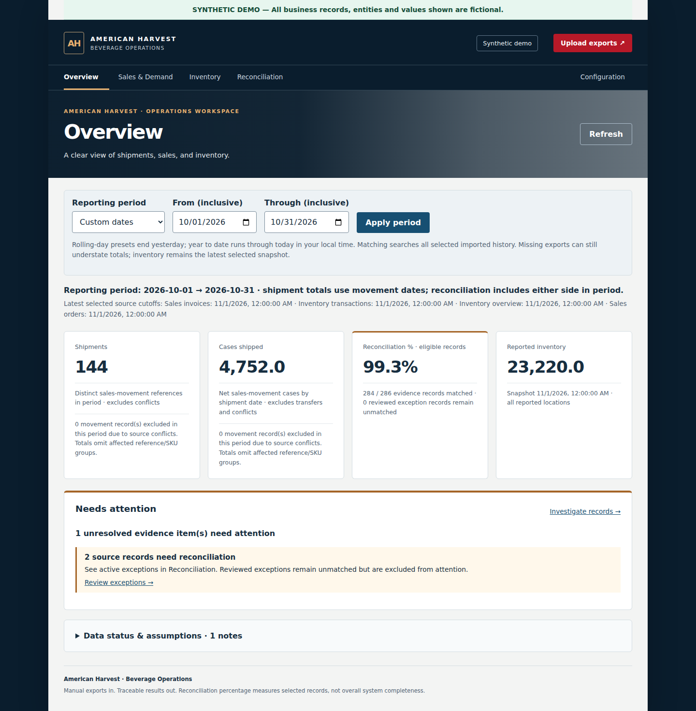
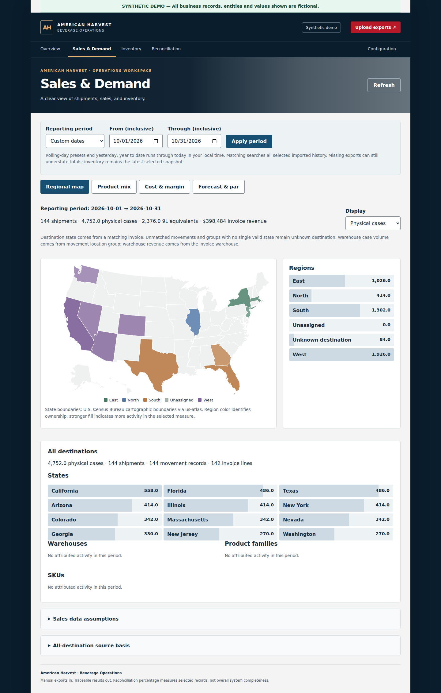

# Beverage Operations Evidence Platform

**Technical case study · deterministic reconciliation · inventory planning · private AWS demonstration**

The purpose of this platform is **executive visibility over business actions
with evidence that can be checked**. For the connected sources, a leader can
see what was reported in stock, what physically shipped, what was invoiced,
which facts agree, and which exceptions still require review. The application
supports decisions; it does not make the business decision for the operator.

Recurring exports had made a basic question hard to answer: how many physical
cases were invoiced, and how many actually shipped? A warehouse partner
used distinct source codes for legitimate stock-handling needs. Those variants
split quantities that the business needed to review together as one configured
product family and size. Every Monday, the owner and another internal executive
spent about an hour on an inventory-reconciliation call after a warehouse tally
and manual comparison with reported accounting inventory. As of November 5,
2026, the owner reports that this Monday call is gone after roughly six weeks
of using the new workflow. That removes an approximately one-hour weekly
meeting for two internal participants. File preparation and review still take
time, so this case study does not claim a measured net labor saving or annual ROI.

The owner now downloads four recurring exports and reviews them through the
application instead of assembling a variable set of per-product sales files
and pivot tables. The application ingests dated operational exports, keeps
their source lineage, resolves overlapping observations, and presents shipment,
invoice, inventory, and exception evidence with their different meanings
intact. It also compares available cases with historical outbound rates to
show weeks of supply and configured family targets. That planning view is a
baseline for inspection, not a validated stockout prediction or purchase
instruction.

## System at a glance

The core calculations are deterministic. A private AWS demonstration placed an
authenticated HTTPS load-balancer and Cognito entry in front of a single EC2
application host; the application also enforced roles and protected writes.
That deployment was verified in a September 24, 2026 release. I have not verified its
current live state, and the design is not presented as production-ready public
SaaS. See [architecture and cloud boundary](docs/architecture.md).

## Shipment evidence and reconciliation

### Two useful product identities

The warehouse's variant codes support its stock-handling process. The business
also needs a combined product-family and size view. Explicit assignments
support that aggregation without deleting or rewriting any source SKU. An
operator can still drill down to the original code and location to inspect
how much of each variant remains. If reliable age evidence is added later,
that retained detail could support aging-inventory analysis; the current case
study does not claim an automated stock-age calculation.

An outbound sales movement supports **physical cases shipped** on its movement
date. An invoice supports **invoiced cases** and invoice revenue on its invoice
date; it does not prove that a shipment occurred or that cash was collected.
Matching records are linked, while shipment-only, invoice-only, duplicate, and
conflicting evidence remain traceable. Exact source codes are retained. Family
and size assignments support inventory aggregation; cross-code sales matching
additionally requires a separately reviewed SKU-equivalence decision under the
transaction reference. A bounded case-rounding tolerance can reconcile export
precision differences without changing either source quantity. A
reconciliation percentage describes agreement among eligible records that
were supplied; it does not certify that every relevant export was received.

The [worked example](docs/reconciliation.md) uses four entirely invented source
rows to show a matched pair, one shipment without an invoice, and one invoice
without a shipment. The resulting shipment and invoice totals stay separate.

*Synthetic capture of the real application running against fictional business
records and values. It is not an operational result.*

The [regional view](docs/architecture.md#regional-analysis) connects matched
movement and invoice evidence to geography when a valid destination is known.

*Synthetic capture. Business entities and values are fictional; application
branding and US geography are retained.*

## Regions, product mix, and standard costs

Operators assign states to regions; unassigned and unknown destinations remain
visible. The regional view can compare physical (flat) cases, confirmed 9L
equivalents, or eligible product-invoice revenue. Product mix shows each
family's share of shipment cases beside its share of invoice dollars, then
drills into region and state. Different units and shipment/invoice dates can
produce different shares without either chart being wrong.

Complete standard-cost profiles by family and bottle size support estimated
inventory value and standard COGS, gross profit, and margin on eligible invoice
cases. Missing costs reduce disclosed coverage rather than becoming zero.
These are operational standard-cost estimates, not accounting income or cash.
See the [fictional commercial-analysis example](docs/commercial-analysis.md).

## Inventory planning from observed rates

The planning view groups outbound sales movements and outbound transfers by
warehouse, product family, and size. For a selected 30-, 90-, or 180-day window,
it computes an average weekly outbound rate and divides available snapshot cases
by that rate to show estimated weeks of supply. Configured family target weeks
provide a separate par comparison. Cycling-out items remain visible without
creating replenishment pressure.

The window choices and fixed under-10-week inspection signal are project-selected
heuristics. They have not been established by backtesting against operating
outcomes. The method does not model seasonality, future receipts, routing, or
safety stock. See the [fictional calculation and limits](docs/inventory-planning.md).

## Weekly sales reporting

The owner describes a separate weekly sales-reporting workflow that previously
required another set of downloads, spreadsheet imports, and pivot-chart
preparation. The connected application now presents weekly, month-to-date,
and year-to-date invoice results with comparison periods so the owner can
spend that review on analysis. This is an owner-reported process change; no
report-preparation minutes have been measured. Report previews and readiness
checks exist, while automatic report email delivery remains disabled.

## Development workflow

The owner defined the operational questions, evidence semantics, acceptance
criteria, and release decisions. Spec Kit helped turn representative features
into reviewable specifications, plans, tasks, and validation steps. AI-assisted
implementation was bounded by those artifacts and checked against tests and
owner review. This describes a documented workflow example; it does not imply
every change used the full sequence. See [development workflow](docs/development-workflow.md).

## Data handling

Company information was treated as a private asset throughout preparation of
this case study. The operational repository and its history remain private.
No production exports, databases, customer records, prices, correspondence,
credentials, or original operational screenshots are included here. The two
images above are the only screenshots in this case study; they were captured from the
application using invented data and checked against the approved image bytes.
See [data handling and review boundary](docs/data-handling.md).

This repository is a case study, not a copy of the operational application.
Application source code and private Spec Kit artifacts are not included in this
initial package.

## What the evidence does and does not show

- **Shown:** source-to-result reasoning, visible exceptions, dated cloud-demo
  architecture, and a historical-rate inventory-planning method.
- **Owner-reported:** the hour-long Monday call is gone after roughly six weeks
  of use; separate weekly Excel and pivot preparation was removed. Total labor
  saved across both workflows has not been measured.
- **Not claimed:** complete source coverage from a match percentage, cash from
  invoice revenue, a validated stockout date, production cloud readiness, or
  current live availability of the historical AWS deployment.
