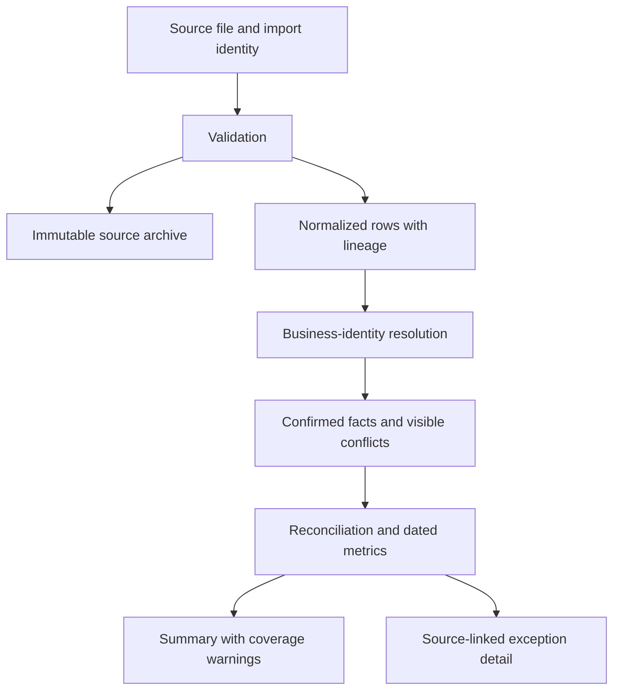
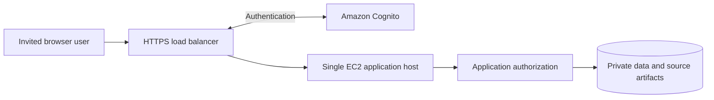

# Evidence Architecture and Private Cloud Boundary

## Source-to-result path

The application treats each accepted export as dated evidence. Validation
precedes import; the original artifact and row lineage are retained. Normalized
observations let separate exports contribute without replacing their original
identity. Overlapping observations are deduplicated by documented business
identity. Conflicting versions are shown and withheld from affected totals
until reviewed.

The executive sees which business actions the connected sources support: stock
reported, cases shipped, cases invoiced, exceptions reviewed, and planning
signals needing judgment. The operator can inspect what was observed, what was
matched, what was missing, and which selected period or snapshot produced the
result. A successful
match never substitutes for a source-coverage assessment.

Warehouse-specific product codes remain intact in source evidence. Reviewed
family and size assignments can support a commercial product view across code
variants, while the original labels stay available for audit. A sales match
between different source codes needs an additional explicit, reviewed
equivalence decision; shared family and size do not prove that association.
This bridges two legitimate identities without pretending the warehouse's
stock-handling codes were invalid or silently changing matching keys.

For illustration, two **fictional** source SKUs, `SAMPLE-750-A` and
`SAMPLE-750-B`, may hold 10 and 9 cases at one location. After explicit
assignment to the same family and 750 mL size, the family/size view can show
19 cases while the source-level view still shows 10 and 9 separately. This is
aggregation for decision support, not destruction of warehouse identity.
Retaining the source code leaves a path to later aging-stock analysis if a
trustworthy age or lot-date basis is supplied. The current application does
not infer that one variant is three years old from its suffix alone.

## Private AWS demonstration

A dated 2026 release verified a private AWS demonstration with an HTTPS
Application Load Balancer, Amazon Cognito authentication, and a single EC2
application host. The application checked asserted identity, roles, trusted
hosts/origins, and protected writes. Data storage remained behind the
application boundary. The branded public entry was separated from protected
operational routes.

This is a **historically verified private demonstration**, not a claim that
the endpoint is currently live or that the application is ready for public
production use. The reviewed source documentation identifies remaining work
including reproducible infrastructure, backup/recovery, encrypted persistence,
network isolation, managed secrets, and concurrency planning. No private URL,
account identifier, or operating configuration is included in this case study.

## Regional analysis

When movement and invoice evidence supports a unique valid destination, the
application can summarize physical shipment cases by state and region and
drill into warehouse, family, and SKU. Unknown destination remains explicit;
geography is not invented from an unmatched movement. The map in the README
uses synthetic business records and values.
